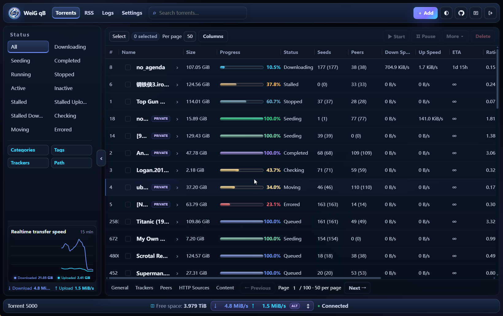
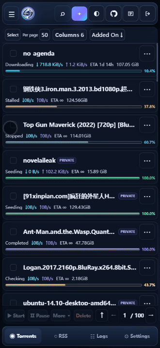
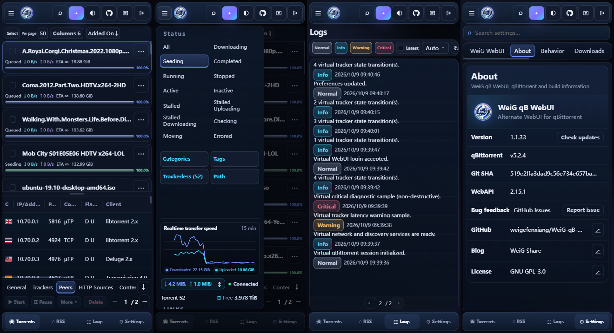

# WeiG qB WebUI

Una Alternate WebUI moderna y adaptable para qBittorrent, optimizada para escritorio y móvil.

**📱 Adaptada a móvil · 🌙 Modo oscuro · ✅ Compatible con qBittorrent 4.1.x → 5.2.x**

<p>
  
  
  
  
  
</p>

**[🌐 Vista previa en línea](https://weigefenxiang.github.io/WeiG-qB-WebUI/)** · **[⬇️ Descargar la última versión estable](https://github.com/weigefenxiang/WeiG-qB-WebUI/releases/latest)**

<!-- WEIG-README-LANGUAGES:START -->
**Idioma**: [English](../README.md) · [简中](README.zh-CN.md) · [繁中](README.zh-TW.md) · [日本語](README.ja.md) · [한국어](README.ko.md) · [Deutsch](README.de.md) · [Français](README.fr.md) · **Español** · [Português](README.pt.md) · [Русский](README.ru.md)

<details>
<summary><b>🔤 Más idiomas</b></summary>

<div dir="ltr">
<a href="README.az-Latn.md">Azərbaycanca</a> &lrm;·&lrm; <a href="README.be.md">Беларуская</a> &lrm;·&lrm; <a href="README.bg.md">Български</a> &lrm;·&lrm; <a href="README.bs.md">Bosanski</a> &lrm;·&lrm; <a href="README.ca.md">Català</a> &lrm;·&lrm; <a href="README.cs.md">Čeština</a> &lrm;·&lrm; <a href="README.da.md">Dansk</a> &lrm;·&lrm; <a href="README.el.md">Ελληνικά</a> &lrm;·&lrm; <a href="README.en-AU.md">English (Australia)</a> &lrm;·&lrm; <a href="README.en-GB.md">English (UK)</a> &lrm;·&lrm; <a href="README.eo.md">Esperanto</a> &lrm;·&lrm; <a href="README.et.md">Eesti</a> &lrm;·&lrm; <a href="README.eu.md">Euskara</a> &lrm;·&lrm; <a href="README.fi.md">Suomi</a> &lrm;·&lrm; <a href="README.gl.md">Galego</a> &lrm;·&lrm; <a href="README.hi-IN.md">हिन्दी</a> &lrm;·&lrm; <a href="README.hr.md">Hrvatski</a> &lrm;·&lrm; <a href="README.hu.md">Magyar</a> &lrm;·&lrm; <a href="README.hy.md">Հայերեն</a> &lrm;·&lrm; <a href="README.id.md">Bahasa Indonesia</a> &lrm;·&lrm; <a href="README.is.md">Íslenska</a> &lrm;·&lrm; <a href="README.it.md">Italiano</a> &lrm;·&lrm; <a href="README.ka.md">ქართული</a> &lrm;·&lrm; <a href="README.kk.md">Қазақша</a> &lrm;·&lrm; <a href="README.lt.md">Lietuvių</a> &lrm;·&lrm; <a href="README.ltg.md">Latgalīšu</a> &lrm;·&lrm; <a href="README.lv-LV.md">Latviešu</a> &lrm;·&lrm; <a href="README.mn-MN.md">Монгол</a> &lrm;·&lrm; <a href="README.ms-MY.md">Bahasa Melayu</a> &lrm;·&lrm; <a href="README.nb.md">Norsk bokmål</a> &lrm;·&lrm; <a href="README.ne-NP.md">नेपाली</a> &lrm;·&lrm; <a href="README.nl.md">Nederlands</a> &lrm;·&lrm; <a href="README.oc.md">Occitan</a> &lrm;·&lrm; <a href="README.pl.md">Polski</a> &lrm;·&lrm; <a href="README.pt-BR.md">Português (Brasil)</a> &lrm;·&lrm; <a href="README.ro.md">Română</a> &lrm;·&lrm; <a href="README.sk.md">Slovenčina</a> &lrm;·&lrm; <a href="README.sl.md">Slovenščina</a> &lrm;·&lrm; <a href="README.sq.md">Shqip</a> &lrm;·&lrm; <a href="README.sr.md">Српски</a> &lrm;·&lrm; <a href="README.sr-Latn.md">Srpski</a> &lrm;·&lrm; <a href="README.sv.md">Svenska</a> &lrm;·&lrm; <a href="README.th.md">ไทย</a> &lrm;·&lrm; <a href="README.tr.md">Türkçe</a> &lrm;·&lrm; <a href="README.uk.md">Українська</a> &lrm;·&lrm; <a href="README.uz-Latn.md">Oʻzbekcha</a> &lrm;·&lrm; <a href="README.vi.md">Tiếng Việt</a> &lrm;·&lrm; <a href="README.zh-HK.md">香港繁體</a> &lrm;·&lrm; <a href="README.ar.md">&#x2067;العربية&#x2069;</a> &lrm;·&lrm; <a href="README.fa.md">&#x2067;فارسی&#x2069;</a> &lrm;·&lrm; <a href="README.he.md">&#x2067;עברית&#x2069;</a>
</div>

</details>
<!-- WEIG-README-LANGUAGES:END -->

## Descarga directa

Descarga la última versión estable [**weig-qb-webui.zip**](https://github.com/weigefenxiang/WeiG-qB-WebUI/releases/latest/download/weig-qb-webui.zip). El mismo ZIP sirve también para Linux y NAS.

## Vista previa de la interfaz

### Escritorio

<p align="center">
  
</p>

### Móvil

<p align="center">
  
</p>

## Instalación para principiantes

<details>
<summary><b>¿Es tu primera instalación? Despliega esta guía de 1 minuto</b></summary>

### 1. Extraer el ZIP

Descarga `weig-qb-webui.zip` y extráelo. El archivo ya crea la carpeta canónica:

```text
weig-qb-webui/
├── public/
├── private/
├── VERSION
└── GIT_SHA
```

La carpeta **`weig-qb-webui` completa** es la raíz de la WebUI. No copies solo `public` o `private`.

### 2. Moverla a una ubicación fija

```text
Windows: D:\weig-qb-webui
Linux:   /opt/weig-qb-webui
```

Ese es el directorio que indicarás en qBittorrent.

### 3. Activarla en qBittorrent

Abre qBittorrent:

**Herramientas → Opciones... → WebUI**

Estos son los términos actuales de la traducción oficial al español de qBittorrent. Después:

1. Activa **Usar la interfaz Web alternativa**.
2. Busca **Ubicación de archivos:**.
3. Introduce la ruta de la carpeta `weig-qb-webui`.

Ejemplo en Windows:

```text
D:\weig-qb-webui
```

Ejemplo en Linux:

```text
/opt/weig-qb-webui
```

4. Pulsa **OK** para guardar.
5. Recarga la WebUI. Si sigue apareciendo la interfaz antigua, prueba `Ctrl + F5`.

> **Cómo comprobar la ruta:** dentro del directorio indicado debes ver directamente `public`, `private`, `VERSION` y los demás archivos.

> **Docker:** qBittorrent se ejecuta dentro de un contenedor, por lo que normalmente debes usar una ruta visible desde el contenedor y no la ruta real del host.

</details>

## Instalación con un solo comando

El instalador para Linux/NAS se descarga siempre desde el enlace fijo de Dev Pages que aparece abajo. **La dirección del script no decide el canal de instalación:** sin `-dev` instala la última Release estable verificada; usa `-dev` solo para la versión de desarrollo actual.

### Linux / NAS

```sh
curl -fsSL https://weigefenxiang.github.io/WeiG-qB-WebUI/downloads/dev/install.sh -o install.sh && sh install.sh -configure
```

<details>
<summary><b>Ver ubicación del script y directorio de instalación predeterminado</b></summary>

```text
./install.sh
```

Ruta predeterminada de la WebUI:

```text
~/.local/share/weig-qb-webui
```

Si se ejecuta como `root`:

```text
/root/.local/share/weig-qb-webui
```

</details>

### Docker

<details>
<summary><b>Instalación Docker / varios contenedores / rutas</b></summary>

#### Host y contenedor

- **Host**: el sistema Linux/NAS donde se ejecuta Docker.
- **Contenedor**: el entorno aislado donde se ejecuta qBittorrent.

Ejemplo:

```text
Host:       /root/qbittorrent/config
   ↓ montado como
Contenedor: /config
```

Docker Compose:

```yaml
volumes:
  - /root/qbittorrent/config:/config
```

Si la WebUI está instalada en el host en:

```text
/root/qbittorrent/config/weig-qb-webui
```

entonces **Ubicación de archivos:** en qBittorrent debe ser:

```text
/config/weig-qb-webui
```

#### Un único contenedor qBittorrent

```sh
curl -fsSL https://weigefenxiang.github.io/WeiG-qB-WebUI/downloads/dev/install.sh -o install.sh && sh install.sh -configure
```

El instalador intenta detectar automáticamente el contenedor y el montaje `/config`.

#### Listar contenedores

Consulta primero los contenedores de qBittorrent disponibles:

```sh
sh install.sh --list-containers
```

También puedes usar Docker directamente:

```sh
docker ps
```

Si el contenedor se llama, por ejemplo:

```text
qbittorrent
```

Selecciónalo expresamente:

```sh
sh install.sh --container=qbittorrent -configure
```

#### Elegir un contenedor cuando hay varios

Por ejemplo, si tienes una instancia habitual y otra de pruebas:

```text
qbittorrent
qbittorrent-test
```

Muestra la lista antes de elegir:

```sh
sh install.sh --list-containers
```

Para la instancia principal:

```sh
sh install.sh --container=qbittorrent -configure
```

Para la instancia de pruebas:

```sh
sh install.sh --container=qbittorrent-test -configure
```

El instalador no escoge ningún contenedor al azar.

#### Indicar el directorio del host montado como `/config`

Si el directorio de configuración de qBittorrent en el host es:

```text
/root/qbittorrent/config
```

Puedes indicar directamente esa ruta:

```sh
sh install.sh --config-root=/root/qbittorrent/config -configure
```

En un NAS Synology podría ser:

```sh
sh install.sh --config-root=/volume1/docker/qbittorrent -configure
```

En otro NAS, por ejemplo:

```sh
sh install.sh --config-root=/share/Container/qbittorrent -configure
```

Sustituye estas rutas por el directorio real de `/config` en el host.

#### Elegir la ruta WebUI

```sh
sh install.sh --container=qbittorrent -o /config/weig-qb-webui -configure
```

#### Actualizar varias instalaciones WebUI de una sola vez

En Linux o NAS puedes repetir `-o` para actualizar varias instalaciones existentes con una sola descarga. No combines esta opción con `-configure`, `--container` ni `--config-root`.

```sh
sh install.sh -dev \
  -o /root/qbittorrent/config/weig-qb-webui \
  -o /root/qbittorrent3/config/weig-qb-webui
```

#### Comprobar las rutas después de instalar

La salida distingue la ruta del host de la que ve qBittorrent:

```text
Host install path: /root/qbittorrent/config/weig-qb-webui
qBittorrent Root Folder: /config/weig-qb-webui
```

En qBittorrent, **Files location** debe apuntar a la segunda ruta, no a la del host. Con `-configure`, el instalador la establece automáticamente si logra actualizar la configuración.

</details>

### Windows PowerShell

```powershell
Invoke-WebRequest https://weigefenxiang.github.io/WeiG-qB-WebUI/downloads/dev/install.ps1 -OutFile .\install.ps1; powershell -ExecutionPolicy Bypass -File .\install.ps1 -configure
```

<details>
<summary><b>Ver directorio de instalación</b></summary>

```text
C:\Users\<tu-usuario>\AppData\Local\weig-qb-webui
```

</details>

## Opciones habituales
Los nombres de parámetros de PowerShell no distinguen mayúsculas y minúsculas.

| Uso | Linux / Docker / NAS | Windows PowerShell |
|---|---|---|
| Última Release estable | Predeterminado | Predeterminado |
| Release específica | `-version 1.2.0` | `-version 1.2.0` |
| Versión de desarrollo | `-dev` | `-dev` |
| Directorio de instalación | `-o /path` o `-o /path` | `-o D:\path` o `-output D:\path` |
| Archivo de configuración qBittorrent personalizado | — | `-qbconfig D:\path\qBittorrent.ini` |
| Configurar qBittorrent | `-configure` | `-configure` |
| Restaurar instalación anterior | `-rollback` | `-rollback` |
| Desinstalación completa (sin copias del instalador) | `-uninstall -purge` | `-uninstall -purge` |
| Ayuda | `-help` | `-help` |
| Elegir contenedor Docker | `--container=NAME` | — |
| Listar contenedores Docker | `--list-containers` | — |
| Ruta del host montada como `/config` | `--config-root=/path` | — |

<details>
<summary><b>Notas: (haz clic para desplegar)</b></summary>

- Una versión inexistente no cambia automáticamente a latest o dev.
- `-dev` no puede combinarse con `-version`.

### Versión específica y directorio de instalación

Linux:

```sh
sh install.sh -version 1.2.0 -o /opt/weig-qb-webui -configure
```

Windows:

```powershell
powershell -ExecutionPolicy Bypass -File .\install.ps1 -version 1.2.0 -o D:\weig-qb-webui -configure
```

### Reversión

Rollback:

```sh
sh install.sh -rollback
```

```powershell
powershell -ExecutionPolicy Bypass -File .\install.ps1 -rollback
```

</details>

## Desinstalación con un solo comando

<details>
<summary><b>Desinstalación completa para Linux / NAS, Docker y Windows PowerShell</b></summary>

De forma predeterminada se recomienda la **desinstalación completa sin conservar copias del instalador**: elimina el WebUI, desactiva la interfaz alternativa correspondiente, purga las copias / el estado de rollback propiedad de ese destino y después elimina el script de instalación descargado en el directorio actual.

### Linux / NAS

```sh
sh install.sh -uninstall -configure -purge && rm -f -- ./install.sh
```

Para una ruta personalizada, añade `-o /path/to/weig-qb-webui`.

### Docker

Un contenedor / detección automática:

```sh
sh install.sh -uninstall -configure -purge && rm -f -- ./install.sh
```

Varios contenedores:

```sh
sh install.sh -uninstall -configure -purge --container=qbittorrent && rm -f -- ./install.sh
```

Al usar `--config-root`:

```sh
sh install.sh -uninstall -configure -purge --config-root=/path/to/qbittorrent/config && rm -f -- ./install.sh
```

### Windows PowerShell

```powershell
powershell -ExecutionPolicy Bypass -File .\install.ps1 -uninstall -configure -purge; if ($LASTEXITCODE -eq 0) { Remove-Item .\install.ps1 -Force }
```

Para una ruta personalizada, añade `-o D:\weig-qb-webui`.

`-purge` solo elimina las copias pertenecientes al destino que se está desinstalando y no afecta a otras instalaciones. Si el directorio de estado compartido queda vacío, también se elimina `~/.config/weig-qb-webui` en Linux (root: `/root/.config/weig-qb-webui`) o `%APPDATA%\weig-qb-webui` en Windows.

Para conservar las copias y poder usar `-rollback` más adelante, simplemente omite `-purge`.

</details>

## Más ayuda

Para Docker, NAS, rutas personalizadas, actualizaciones e instalación manual, consulta [Instalación, actualización y despliegue manual](installation-guide/deployment-guide.es.md).

## Licencia

[GNU General Public License v3](../LICENSE).

Copyright © 2026 Wei.G / WeiG Share.
